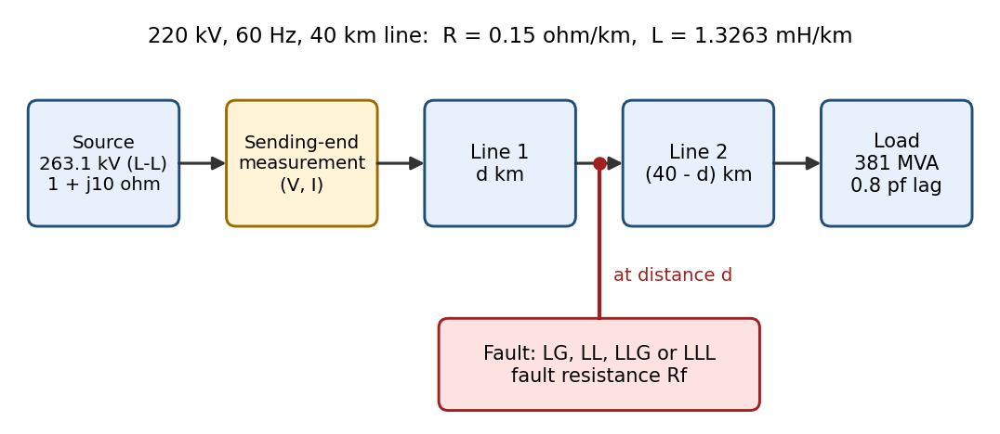
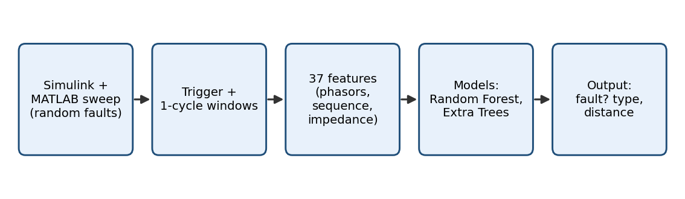
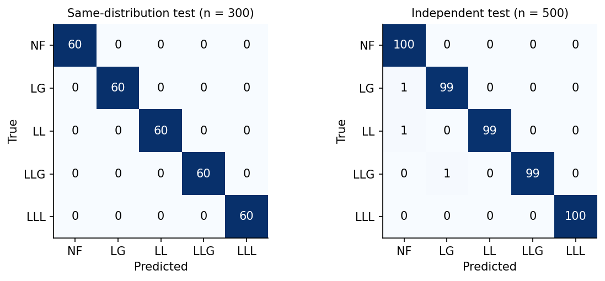
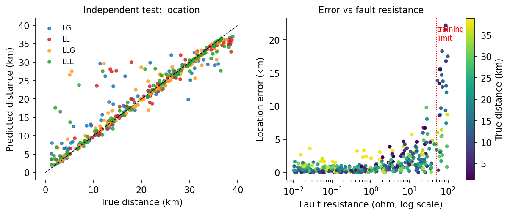

# Transmission-Line Fault Detection, Classification and Location with Machine Learning

A simulation-based study of a 220 kV, 60 Hz, 40 km transmission line. A MATLAB/Simulink model generates thousands of randomised faults, a trigger detects each one, and machine-learning models then identify the **fault type** and estimate **how far along the line** it happened.



## What it does

1. **Detects** a fault from the sending-end current with a one-cycle RMS trigger (no knowledge of the true fault time).
2. **Classifies** it as line-to-ground (LG), line-to-line (LL), double line-to-ground (LLG) or three-phase (LLL), or as no fault (NF), using a Random Forest.
3. **Locates** it (distance in km from the sending end) using an Extra Trees regressor.



## Results

Every number below is recomputed by `python/evaluate_and_figures.py` and stored in `results/metrics.json`.

| | Same-distribution test | Independent test |
|---|---|---|
| Faults missed by trigger | 0 of 1200 | 0 of 400 |
| False alarms (no-fault runs) | 0 of 300 | 0 of 100 |
| Median detection delay | 1.4 ms | 1.4 ms |
| Fault-type accuracy | 100% (n = 300) | **99.4%** (497 of 500, 95% CI 98.3 to 99.9%) |
| Location error, mean | 0.89 +/- 0.11 km (5 splits) | **1.82 km** (95% CI 1.52 to 2.13) |
| Location error, median | 0.66 km | 0.71 km |
| Location error, 90th percentile | not computed | 4.3 km |
| Faults located within 2 km | 85% | 77% |

The **independent test** (500 runs) was generated separately, with a different random seed, and with conditions the training data never covered: different load and power factor, fault resistance up to 100 ohm (training: 50 ohm), fault locations from 1 to 39 km (training: 2 to 38 km), and 1.5 times the measurement noise.




### Where it works and where it does not

- Inside the training range (fault resistance up to 50 ohm) the location error on the independent test is **1.10 km**, close to the 0.9 to 1.1 km on the same-distribution test.
- Above the training range (50 to 100 ohm) the location error rises to **9.3 km**. These 35 faults account for 45% of the total location error. All three fault-type errors also have fault resistances of 85 to 94 ohm. Tree-based models cannot extrapolate beyond the data they were trained on.
- Locations near the line ends (outside the 2 to 38 km training range) have larger errors (2.95 km versus 1.76 km elsewhere).
- Fault-type accuracy is easy to get on this simulator: a depth-4 decision tree on three features reaches 100% on the same-distribution test. Fault **location** is the harder task.
- Ablation: removing the resistance and reactance features raises the same-distribution location error from 0.89 to 1.57 km, and the error for 10 to 50 ohm faults from 2.1 to 4.4 km.
- A simple classical baseline (single-ended loop-reactance estimate, given the **true** faulted phases) has a mean error of 1.88 km on the training data and 3.09 km on the independent test, so the model cuts the error by roughly 40 to 50%. This baseline has no DC-offset filtering, so it is not a tuned protection-relay algorithm.

## Limitations (please read)

- Everything is simulated by one Simulink model built for this project. The independent test varies operating conditions, **not** the model structure. There is no real-world data.
- The line is a lumped RL model: zero-sequence impedance equals positive-sequence (real lines are about 2 to 3.5 times higher), and there is no shunt capacitance.
- Measurement errors are simple: fixed CT/VT gain errors plus Gaussian noise. There is no CT saturation or harmonics.
- No non-fault disturbances (load switching, capacitor switching, inrush) were simulated, so "0 false alarms" applies only to steady-state operation.
- One line, one source strength, one topology.
- Classes are balanced (300 per type), unlike real systems where line-to-ground faults dominate.

## Repository layout

```
fault-detection-ml/
|-- README.md
|-- LICENSE
|-- requirements.txt
|-- matlab/
|   `-- run_fault_sweep.m        # batch fault simulation, feature extraction
|-- simulink/
|   |-- README.md                   # how the model is built, block names, parameters
|   `-- model_screenshot.png
|-- data/
|   |-- README.md                   # column dictionary
|   |-- fault_dataset_train.csv     # 1500 runs
|   `-- fault_dataset_ood.csv       # 500 independent runs
|-- python/
|   |-- train_fault_models.py       # trains and evaluates the models, writes a results PDF
|   `-- evaluate_and_figures.py     # recomputes every reported number, draws figures
|-- results/
|   |-- metrics.json
|   `-- fault_ml_results.pdf
|-- figures/                        # figures used in the report
`-- docs/
    |-- report.tex
    `-- report.pdf
```

## Reproduce

1. **Simulink model:** build or open the model described in `simulink/README.md` (add your `.slx` file to that folder).
2. **Generate data (MATLAB R2016b or newer):** in `matlab/run_fault_sweep.m` set `FULL_RUN = true`, run once with `DATASET = 'train'` (about 75 minutes) and once with `DATASET = 'ood'` (about 25 minutes). The ready-made CSVs are already in `data/`.
3. **Train and evaluate:**
   ```bash
   pip install -r requirements.txt
   python python/train_fault_models.py data/fault_dataset_train.csv data/fault_dataset_ood.csv
   python python/evaluate_and_figures.py
   ```
   Run both from the repository root. The first script also saves the trained models (`fault_classifier.joblib` and `fault_locator.joblib`). The locator is about 70 MB, so it is not committed.

## Method in brief

- **Fault generation:** the line is split into two sections at a random distance *d* (2 to 38 km), with a fault block at the join. Fault type, phases, fault resistance (0.01 to 50 ohm, log-uniform), inception time and load (plus or minus 20%) are randomised.
- **Measurements:** sending-end voltages and currents at 21.6 kHz, with CT/VT gain errors (plus or minus 0.5% and 1%) and sensor noise (0.2% of nominal peak).
- **Trigger:** fires when the one-cycle RMS of any phase current reaches 1.3 times its value one cycle earlier.
- **Features (37):** one-cycle phasor magnitudes, post/pre-fault ratios, sequence components (zero, positive, negative) and their ratios, and apparent resistance and reactance per phase, per phase pair and in positive sequence. The locator adds 10 derived impedance features.
- **Models:** Random Forest (300 trees) for type, Extra Trees (400 trees) for location. Labels and fault settings (type, phases, resistance, distance, inception time) are never given to the models as inputs.

## History: why this is version 2

The first version of the dataset gave 100% accuracy. That was suspicious, and checking showed why: the simulated no-fault signals were numerically perfect (sequence components of 1e-10), the analysis windows were aligned to the true fault time, and there was no independent test. Version 2 adds measurement errors and noise, a trigger that does not know the fault time, impedance features, and a separate test set with conditions the training data never covered.

## Future work

- Train with fault resistance up to about 150 ohm and test on a fresh independent set.
- Use a line model with distinct zero-sequence parameters and shunt capacitance.
- Add non-fault disturbances (load switching, inrush) to test false alarms honestly.
- Add DC-offset filtering and CT saturation, and compare against a tuned classical locator.

## Tools

MATLAB/Simulink (Simscape Electrical), Python, scikit-learn, pandas, NumPy, SciPy, Matplotlib.

## License

MIT, see `LICENSE`.

## Author

Ludwig Siisi Ben-Acquaah
